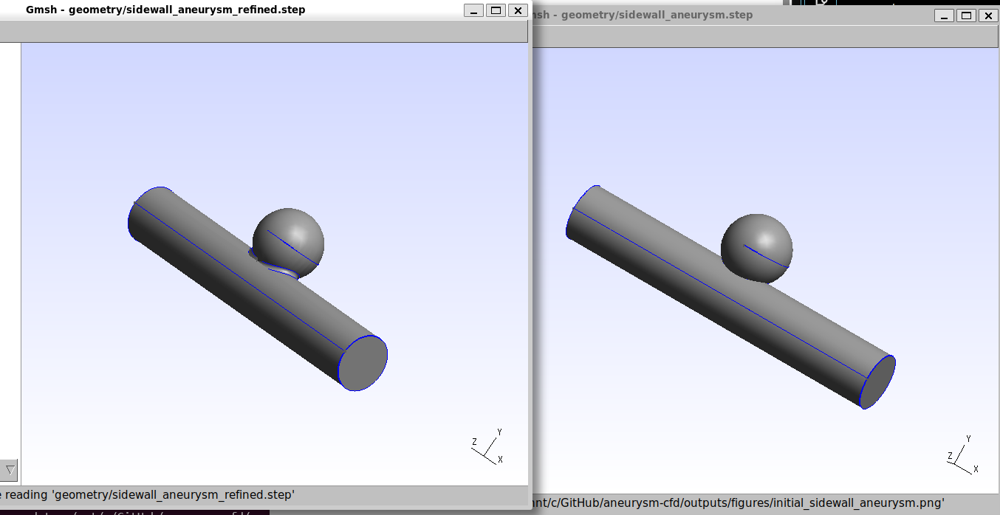
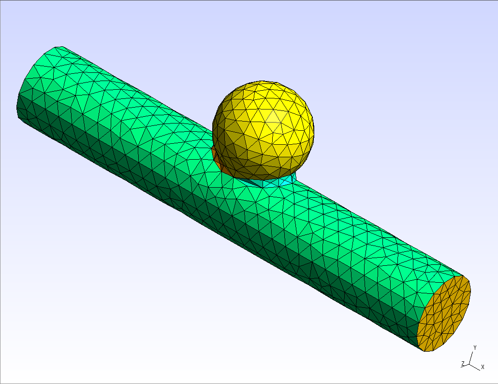
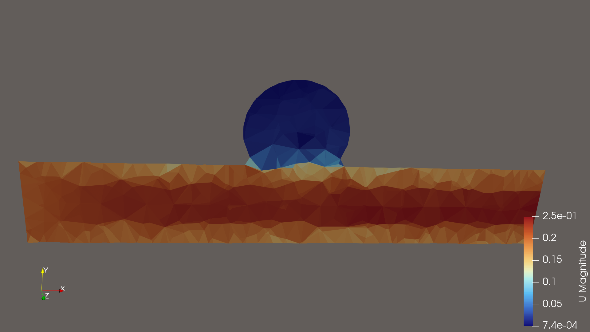
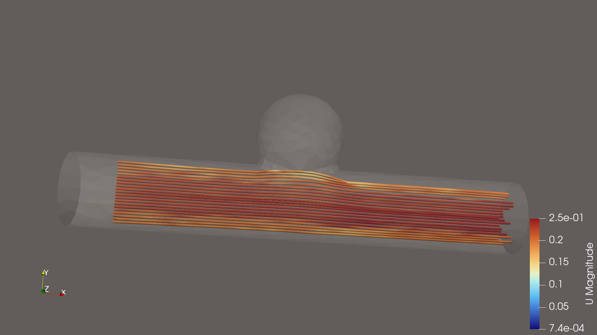
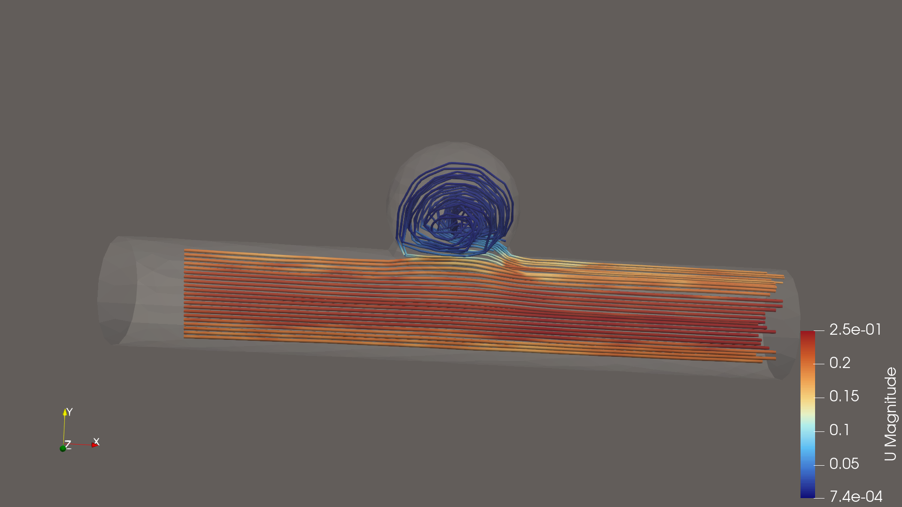
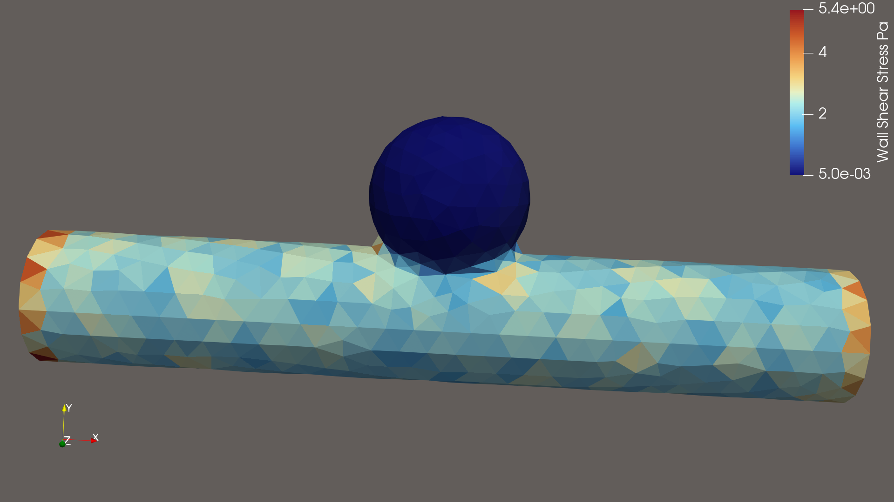
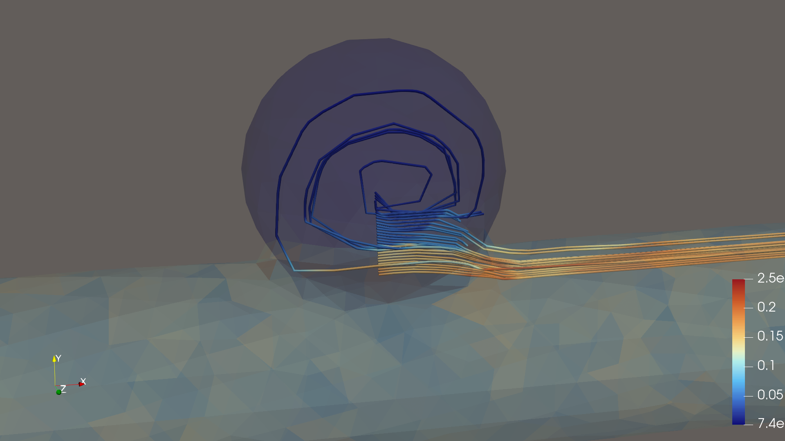
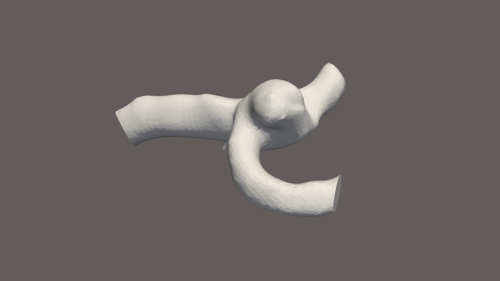
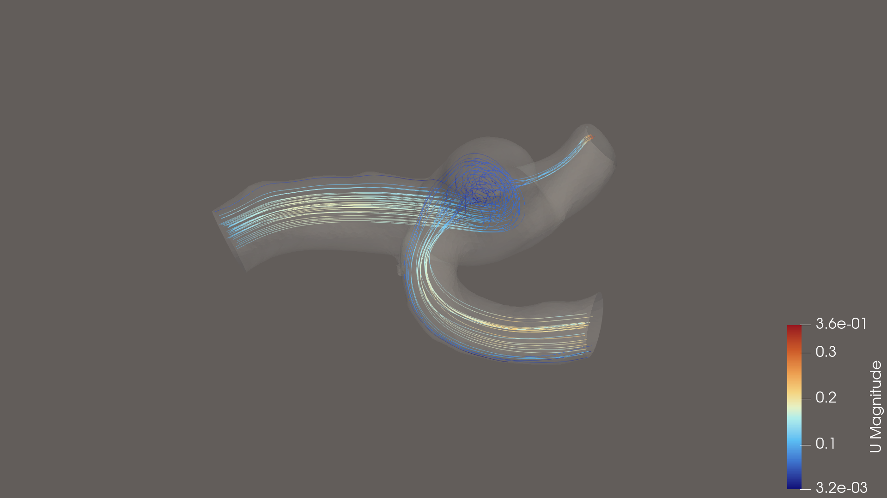
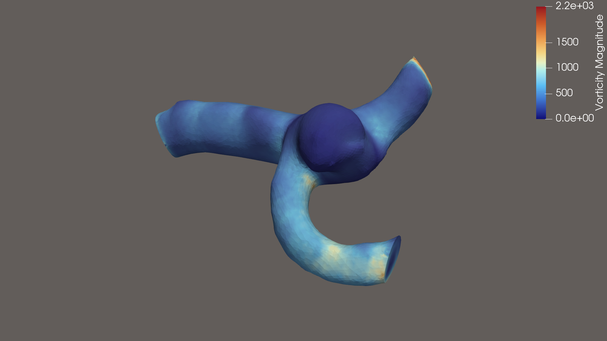

# Intracranial Aneurysm Haemodynamics — Computational Fluid Dynamics

**A computational investigation of intracranial aneurysm haemodynamics using synthetic and patient-derived vascular geometries, OpenFOAM and ParaView.**

**Project status:** Preliminary CFD simulations completed for both a synthetic sidewall aneurysm and a patient-derived middle cerebral artery (MCA) bifurcation aneurysm. Velocity distributions, flow streamlines and exploratory haemodynamic visualisations have been generated. Mesh refinement, numerical validation and further patient-derived wall shear stress analysis remain ongoing.

## Clinical Background

Intracranial aneurysms are pathological dilatations of cerebral arteries that may rupture, resulting in subarachnoid haemorrhage.

Although aneurysm size, location, morphology and patient-related factors inform clinical risk assessment, aneurysm haemodynamics may provide additional insights into the biological mechanisms underlying aneurysm development, progression and rupture.

Computational fluid dynamics (CFD) enables numerical investigation of blood-flow behaviour within vascular geometries, including velocity distributions, pressure gradients, flow recirculation and wall shear stress.

## Research Question

How do changes in intracranial aneurysm geometry influence local haemodynamic characteristics, particularly intra-aneurysmal flow patterns and wall shear stress?

## Project Objectives

1. Construct a simplified three-dimensional model of an intracranial sidewall saccular aneurysm.
2. Generate and validate a computational mesh.
3. Simulate incompressible blood flow using OpenFOAM.
4. Quantify velocity, pressure and wall shear stress distributions.
5. Visualise flow patterns and regions of intra-aneurysmal recirculation.
6. Compare haemodynamic characteristics between different synthetic aneurysm geometries.
7. Evaluate numerical reliability and document modelling assumptions and limitations.

## From Aneurysm Geometry to Computational Mesh

### 1. Constructing a Synthetic Intracranial Aneurysm

A simplified three-dimensional model of a sidewall saccular intracranial aneurysm was constructed using Python and Gmsh.

The model consists of a straight parent artery measuring 5 mm in diameter and 30 mm in length, with a 6 mm diameter aneurysm sac arising from its sidewall.

The artery and aneurysm were combined into a continuous fluid domain. The aneurysm neck was subsequently refined using a geometric fillet to create a smoother transition between the parent artery and aneurysm sac.



*Figure 1. Comparison of the initial synthetic sidewall aneurysm and the model following geometric refinement of the aneurysm neck. The geometry is illustrative and does not represent patient-specific anatomy.*

### 2. Generating the Computational Mesh

To simulate blood flow, the continuous three-dimensional aneurysm geometry must be divided into many smaller computational cells. This process is called **meshing**.

Gmsh was used to generate an initial tetrahedral mesh, comprising 3,882 three-dimensional cells and 1,079 nodes.




*Figure 2. Preliminary computational mesh of the synthetic sidewall intracranial aneurysm. The triangular elements visible on the surface form the boundaries of the three-dimensional tetrahedral mesh. The aneurysm sac and parent artery are represented as a continuous fluid domain.*


The mesh was assigned three boundary regions:

- **Inlet:** The opening through which blood enters the parent artery.
- **Outlet:** The opening through which blood leaves the parent artery.
- **Vessel walls:** The surfaces of the parent artery and aneurysm sac.

These boundaries allow different physiological conditions to be specified during subsequent CFD simulations.

### 3. Validating the Computational Mesh

The mesh was exported from Gmsh and successfully imported into OpenFOAM 14.

OpenFOAM's `checkMesh` utility was used to assess the mesh's geometric and topological integrity.

| Mesh characteristic | Result |
|---|---|
| Three-dimensional cells | 3,882 tetrahedra |
| Mesh nodes | 1,079 |
| Connected fluid regions | 1 |
| Boundary regions | Inlet, outlet, walls |
| Maximum cell aspect ratio | 7.97 |
| Maximum non-orthogonality | 69.06° |
| Maximum skewness | 1.038 |
| OpenFOAM mesh validation | **Passed (`Mesh OK`)** |

The initial mesh passed OpenFOAM's standard quality checks, establishing a suitable starting point for preliminary numerical experiments.

However, passing these checks does not demonstrate that the mesh is sufficiently refined for accurate haemodynamic measurements. Further refinement, particularly near the aneurysm neck and vessel walls, and a mesh-convergence study will be required before interpreting quantitative wall shear stress results.

## Simulation Results

The synthetic aneurysm was investigated using a steady-state, incompressible, laminar-flow simulation in OpenFOAM 14. The following visualisations demonstrate the resulting velocity distribution, flow recirculation and wall shear stress.

These results are preliminary and intended to demonstrate the computational workflow rather than provide clinically validated haemodynamic measurements.

### 1. Blood-flow Velocity Distribution



*Figure 3. Longitudinal cross-section showing blood-flow velocity magnitude within the synthetic sidewall aneurysm and parent artery.*

The simulation demonstrates relatively faster flow through the parent artery and lower velocities within portions of the aneurysm sac.

This pattern is consistent with the development of regions of slower blood movement within an aneurysmal dilatation. Such regions may be relevant to blood residence time and thrombosis, although neither can be reliably predicted from this preliminary steady-state simulation alone.

### 2. Blood-flow Streamlines and Intra-aneurysmal Recirculation

Streamlines illustrate the direction of blood flow through the parent artery and aneurysm. They provide a useful way to visualise how the aneurysm alters the local flow pattern.



*Figure 4. Velocity-coloured streamlines illustrating blood flow through the parent artery adjacent to the synthetic aneurysm.*



*Figure 5. Combined visualisation of parent-artery flow and apparent intra-aneurysmal recirculation. Streamlines are coloured by velocity magnitude, with the vessel walls rendered semi-transparent.*

The simulation demonstrates relatively direct flow through the parent artery and more complex flow trajectories within the aneurysm sac, including apparent recirculation.

**Clinical relevance:** Flow recirculation and regions of reduced velocity may influence blood residence time and local thrombotic processes. However, recirculation does not necessarily indicate turbulence, and the present steady-state simulation cannot establish thrombus formation or predict aneurysm rupture.

### 3. Wall Shear Stress Distribution

Wall shear stress (WSS) describes the tangential force exerted by flowing blood on the vessel wall. It is an important haemodynamic parameter in research investigating intracranial aneurysm development, vascular remodelling and rupture.



*Figure 6. Preliminary wall shear stress distribution across the synthetic sidewall aneurysm and parent artery, expressed in pascals (Pa).*

The simulation demonstrates relatively low calculated WSS within much of the aneurysm sac, compared with portions of the parent artery. The distribution is heterogeneous, particularly around the aneurysm neck and along the parent vessel.

WSS was calculated using OpenFOAM's `wallShearStress` function and converted from kinematic stress to dynamic stress using the assumed blood density:

\[
\mathrm{WSS\ (Pa)} = 1060 \times |\mathrm{wallShearStress}|
\]

**Clinical relevance:** Both elevated and reduced WSS have been implicated in different pathways of aneurysm wall remodelling. Low WSS may be associated with endothelial dysfunction and inflammatory processes, while elevated WSS and local flow impingement may contribute to other forms of vascular wall injury.

These relationships are complex, and WSS alone cannot reliably predict aneurysm rupture or thrombosis.

**Numerical limitation:** The present mesh contains only 3,882 tetrahedral cells and lacks dedicated near-wall refinement. Consequently, the WSS distribution should be interpreted qualitatively. The reported values have not been established as mesh-independent or clinically accurate.

### 4. Intra-aneurysmal Flow and Recirculation



*Figure 7. Close-up visualisation of velocity-coloured streamlines within the synthetic sidewall aneurysm. The translucent vessel surface reveals recirculating flow within the aneurysm sac, contrasting with the predominantly axial flow in the parent artery.*

The simulation demonstrates a region of relatively slow, recirculating flow within the aneurysm sac. Streamlines entering the aneurysm neck follow curved trajectories within the sac, while much of the parent arterial flow continues downstream.

The streamlines are coloured according to velocity magnitude (m/s), with blue indicating lower velocities and yellow-to-red indicating higher velocities.

**Clinical relevance:** Intra-aneurysmal flow patterns, including recirculation, flow impingement and regions of low velocity, are relevant to research investigating aneurysm haemodynamics, wall remodelling and thrombosis.

**Numerical limitation:** These streamlines represent a steady-state laminar flow solution and should not be interpreted as evidence of turbulence. Their appearance depends partly on streamline seed placement. The coarse mesh, idealised geometry and simplified boundary conditions limit quantitative and clinical interpretation.

### 5. Mass Conservation Check

Global volumetric flow balance was assessed using OpenFOAM's `patchFlowRate` post-processing function applied to the saved solution at simulation time 93.

| Boundary | Volumetric flow rate |
|---|---|
| Inlet | −3.82683 × 10⁻⁶ m³/s |
| Outlet | +3.82683 × 10⁻⁶ m³/s |

The inlet and outlet flow rates were equal in magnitude to the reported numerical precision, corresponding to a calculated global flow-rate discrepancy of 0.000% using the displayed values.

This supports global mass conservation in the saved solution. It does not, however, establish solver convergence, local continuity accuracy or mesh independence, which require additional verification.

### 6. Solver Convergence Verification

The steady-state simulation was continued from the saved solution at iteration 93, with the solver output preserved in the [convergence log](outputs/logs/solver_convergence.txt).

OpenFOAM reported convergence of the SIMPLE algorithm at iteration 101, satisfying the configured residual criteria:

| Variable | Residual threshold |
|---|---|
| Pressure (`p`) | 1 × 10⁻⁵ |
| Velocity (`U`) | 1 × 10⁻⁶ |

At iteration 101, the initial residuals for all three velocity components and pressure were below their respective convergence thresholds.

Together with the inlet–outlet flow balance assessed at iteration 93, these results provide preliminary numerical verification of the CFD solution.

**Limitations:** Residual convergence and global mass conservation do not establish mesh independence or physical accuracy. The current tetrahedral mesh is coarse, lacks dedicated near-wall refinement, and has not undergone a mesh-convergence study. Consequently, wall shear stress distributions remain preliminary and should be interpreted qualitatively rather than as validated haemodynamic measurements.

---

## Patient-Derived Aneurysm CFD Demonstration

In addition to the synthetic aneurysm model, this project aims to demonstrate the application of computational fluid dynamics to a single intracranial aneurysm identified on publicly available, de-identified neurovascular imaging.

### Objectives

1. Identify a suitable open-access CTA, MRA or 3D rotational angiography dataset containing an intracranial aneurysm.
2. Select one imaging case with sufficient anatomical resolution for vascular reconstruction.
3. Segment the aneurysm and parent vessel from the imaging data.
4. Generate a three-dimensional vascular surface model and computational mesh.
5. Apply simplified physiological flow conditions and perform CFD simulation using OpenFOAM.
6. Visualise velocity distributions, intra-aneurysmal flow patterns, pressure and wall shear stress.
7. Compare the practical challenges of image-derived modelling against the synthetic aneurysm simulation.

### Intended Outputs

- Representative angiographic images showing the aneurysm
- Three-dimensional reconstruction of the aneurysm and parent vessel
- Computational mesh visualisation
- Velocity streamlines and flow recirculation patterns
- Wall shear stress distribution over the aneurysm surface

### Data and Methodological Considerations

The imaging dataset will be selected based on accessibility, anatomical suitability, image quality and permissions for research use and publication.

The demonstration will use one de-identified case and will not attempt to predict patient-specific rupture risk.

Where patient-specific physiological measurements are unavailable, flow boundary conditions will be based on explicitly documented assumptions. The resulting haemodynamic measurements will therefore represent an exploratory simulation rather than a clinically validated patient-specific assessment.

## Patient-Derived MCA Aneurysm — Preliminary CFD Results

### Imaging Dataset and Attribution

The patient-derived aneurysm geometry was obtained from the **Royal Brisbane TOF-MRA Intracranial Aneurysm Database**, publicly available through OpenNeuro (dataset **ds005096**).

The dataset was developed using neurovascular imaging obtained through Metro North Hospital and Health Service and the Royal Brisbane and Women's Hospital, Australia.

It contains time-of-flight magnetic resonance angiography (TOF-MRA) examinations, clinician-derived aneurysm and parent-vessel segmentations, and three-dimensional vascular models.

For this demonstration, **subject sub-038** was selected to investigate blood flow within a left middle cerebral artery (MCA) bifurcation aneurysm.

The source vascular geometry was processed for computational meshing and subsequently analysed using OpenFOAM. The CFD simulations, boundary conditions, numerical results and visualisations presented here are independently generated exploratory outputs and should not be attributed to the original dataset authors.

**Dataset and publication references:**

1. de Nys CM, et al. *Time-of-Flight MRA of Intracranial Aneurysms with Interval Surveillance, Clinical Segmentation and Annotations.* Scientific Data. 2024;11:555. https://doi.org/10.1038/s41597-024-03397-8
2. de Nys CM, et al. *Royal Brisbane_TOFMRA_Intracranial Aneurysm_Database.* OpenNeuro, dataset ds005096. https://doi.org/10.18112/openneuro.ds005096.v1.0.0

The original imaging data are not redistributed in this repository. Readers wishing to reproduce the image-derived workflow should obtain the source dataset directly from OpenNeuro.

### Clinical and Computational Objectives

To extend the initial synthetic aneurysm demonstration, a patient-derived intracranial aneurysm geometry was obtained from the publicly available OpenNeuro dataset **ds005096**, using subject **sub-038**.

The selected geometry represents a left middle cerebral artery (MCA) bifurcation aneurysm reconstructed from time-of-flight magnetic resonance angiography (TOF-MRA).

The objective was to investigate whether a patient-derived vascular geometry could be converted into a computational fluid domain suitable for preliminary CFD analysis using OpenFOAM.

This demonstration focuses on computational feasibility and qualitative flow visualisation rather than patient-specific haemodynamic validation or rupture-risk prediction.

### 1. Three-Dimensional Vascular Reconstruction

The image-derived vascular surface was processed to produce a closed computational fluid domain comprising the aneurysm sac and adjoining arterial branches.

The workflow included surface inspection, treatment of vessel openings, surface remeshing, boundary classification and tetrahedral volume-mesh generation.



*Figure 8. Three-dimensional patient-derived MCA bifurcation aneurysm geometry used for exploratory CFD modelling.*

### 2. Computational Mesh

The reconstructed vascular domain was tetrahedralised using TetGen, with subsequent mesh optimisation and boundary classification.

The resulting mesh contained approximately **117,490 tetrahedral cells** and **26,919 mesh points**.

Three vascular openings and the vessel wall were assigned separate boundary regions.

The mesh was imported into OpenFOAM 14 and converted from millimetres to metres.

**Mesh-quality limitations:** OpenFOAM's mesh assessment identified localised non-orthogonality and cell-quality problems. Although the mesh topology was valid and the simulation could be executed, these quality issues require further refinement before quantitative haemodynamic measurements can be considered reliable.

### 3. CFD Simulation

A preliminary steady-state, incompressible, laminar-flow simulation was performed using OpenFOAM Foundation 14.

| Parameter | Preliminary configuration |
|---|---|
| Geometry | Patient-derived left MCA bifurcation aneurysm |
| Mesh | Approximately 117,490 tetrahedral cells |
| Inlet velocity | 0.10 m/s, prescribed uniformly |
| Blood density | 1060 kg/m³ |
| Dynamic viscosity | 0.0035 Pa·s |
| Kinematic viscosity | Approximately 3.30 × 10⁻⁶ m²/s |
| Vessel wall | Rigid, no-slip |
| Outlet conditions | Reference kinematic pressure |
| Flow model | Steady, incompressible, laminar |
| Blood rheology | Newtonian |
| CFD software | OpenFOAM Foundation 14 |

The simulation reached the configured solver residual criteria at iteration **663**.

The selected inlet, outlets and flow boundary conditions were provisional and have not been verified against patient-specific vascular flow measurements.

Consequently, the simulation should be interpreted as a demonstration of the computational workflow, not as a physiologically validated representation of this patient's cerebral circulation.

### 4. Velocity Streamlines and Intra-aneurysmal Flow



*Figure 9. Velocity-coloured streamlines through the patient-derived MCA aneurysm geometry. The visualisation illustrates complex flow trajectories within the aneurysm sac and adjoining arterial branches.*

The preliminary solution demonstrates curved flow trajectories and apparent intra-aneurysmal recirculation.

Streamlines provide an intuitive representation of the simulated velocity field but are sensitive to seed placement and numerical assumptions.

These findings do not establish turbulent flow, thrombosis, aneurysm instability or rupture risk.

### 5. Vorticity Distribution

Vorticity describes the local rotational characteristics of a velocity field and is calculated from the curl of the velocity vector.



*Figure 10. Preliminary vorticity-magnitude visualisation of the patient-derived MCA aneurysm model. Values are expressed in reciprocal seconds (s⁻¹).*

The visualisation demonstrates spatially heterogeneous vorticity, including localised regions of higher calculated magnitude near curved vascular segments and branch junctions.

Because the mesh contains localised quality defects, isolated high-vorticity regions may be influenced by numerical discretisation errors.

Vorticity should not be equated directly with turbulence or wall shear stress.

### 6. Current Limitations and Next Steps

This patient-derived demonstration remains exploratory.

Important limitations include:

- Unverified anatomical inlet and outlet assignments.
- Assumed rather than measured patient-specific flow conditions.
- A steady-state model that does not represent cardiac-cycle pulsatility.
- Rigid vessel walls and Newtonian blood rheology.
- Localised computational mesh-quality deficiencies.
- No mesh-independence or boundary-condition sensitivity study.
- No validation against measured patient-specific haemodynamics.

**Planned next steps** include internal vorticity visualisation, wall shear stress calculation, targeted mesh refinement, assessment of mass conservation and sensitivity analysis.

The present results are intended to demonstrate the feasibility of an image-derived neurovascular CFD workflow and must not be used to guide clinical decision-making.

---

## Computational Methodology

### Geometry

The initial model will consist of a straight cylindrical parent artery with a synthetic sidewall saccular aneurysm.

Preliminary geometric parameters:

- Parent artery diameter: 5 mm
- Aneurysm sac diameter: approximately 6 mm
- Aneurysm neck: to be defined during geometry construction

These dimensions are illustrative and do not represent patient-specific anatomy.

### Fluid Dynamics

Blood flow was modelled using the incompressible Navier–Stokes equations under steady-state, laminar-flow assumptions.

The initial simulation used the following parameters:

| Parameter | Value |
|---|---|
| Parent artery diameter | 5 mm |
| Aneurysm sac diameter | 6 mm |
| Inlet velocity | 0.20 m/s |
| Blood density | 1060 kg/m³ |
| Dynamic viscosity | 0.0035 Pa·s |
| Kinematic viscosity | 3.30 × 10⁻⁶ m²/s |
| Approximate parent-artery Reynolds number | 303 |
| Vessel-wall behaviour | Rigid, no-slip |
| Inlet condition | Uniform prescribed velocity |
| Outlet condition | Reference kinematic pressure of 0 |
| Flow model | Steady, incompressible, laminar |
| Blood rheology | Newtonian |

These assumptions simplify the haemodynamic problem and allow an initial demonstration of the CFD workflow.

In particular, the model does not incorporate cardiac-cycle pulsatility, vessel-wall deformation, patient-specific vascular anatomy or non-Newtonian blood behaviour.

Although the simulation demonstrates apparent intra-aneurysmal recirculation, this should not be interpreted as evidence of turbulent flow.

### Numerical Simulation

The simulation was performed using **OpenFOAM Foundation 14**, employing its `incompressibleFluid` solver and a laminar momentum-transport model.

The computational domain was discretised into 3,882 tetrahedral cells using Gmsh. The mesh was imported into OpenFOAM and passed the `checkMesh` quality assessment.

The governing fluid-flow equations were solved using the finite-volume method. Velocity and pressure fields were subsequently examined in ParaView 6.2.0.

The present simulation represents an initial computational demonstration. A formal assessment of numerical convergence, mesh independence and mass conservation has not yet been documented.

### Haemodynamic Analysis

The following haemodynamic outputs were generated:

- **Velocity magnitude:** Visualised using a longitudinal cross-section through the aneurysm and parent artery.
- **Flow streamlines:** Used to illustrate parent-artery flow and apparent intra-aneurysmal recirculation.
- **Wall shear stress:** Calculated using OpenFOAM's `wallShearStress` function and converted into pascals using the assumed blood density of 1060 kg/m³.

The velocity and WSS distributions were visualised in ParaView.

Although the simulation also produced a pressure field, a dedicated pressure-distribution analysis has not yet been completed.

The resulting haemodynamic patterns are interpreted qualitatively because the preliminary mesh lacks sufficient near-wall refinement and has not undergone a mesh-convergence study.

Future analysis may include pulsatile flow, time-averaged wall shear stress, oscillatory shear index, residence-time estimates and comparisons between different aneurysm geometries.

## Reproducing the Simulation

The repository contains the synthetic aneurysm geometry, mesh-generation script, OpenFOAM case configuration and selected visualisations.

Generated computational meshes and simulation time-step results are excluded from version control to avoid storing unnecessary intermediate files.

### Software Requirements

- OpenFOAM Foundation 14
- Gmsh 4.15.2 with Python bindings
- Python 3.11
- ParaView 6.2.0

### Computational Workflow

**1. Generate the computational mesh**

From the repository root:

```bash
python mesh/01_generate_aneurysm_mesh.py
```

This generates the preliminary tetrahedral mesh from the synthetic aneurysm geometry.

**2. Import the mesh into OpenFOAM**

```bash
gmshToFoam \
    -case cases/synthetic_aneurysm \
    mesh/aneurysm_coarse.msh
```

**3. Check mesh quality**

```bash
checkMesh -case cases/synthetic_aneurysm
```

**4. Run the CFD simulation**

```bash
foamRun \
    -solver incompressibleFluid \
    -case cases/synthetic_aneurysm
```

**5. Calculate wall shear stress**

After obtaining a saved simulation result:

```bash
foamPostProcess \
    -case cases/synthetic_aneurysm \
    -solver incompressibleFluid \
    -func wallShearStress \
    -latestTime
```

For the incompressible model, the resulting kinematic wall shear stress was converted to pascals by multiplying its magnitude by the assumed blood density of 1060 kg/m³.

**6. Visualise the results**

Open `cases/synthetic_aneurysm/synthetic_aneurysm.OpenFOAM` in ParaView.

A saved visualisation state is provided at:

`visualisation/aneurysm_cfd.pvsm`

The state contains the configured visualisation pipeline, including streamline filters and wall shear stress calculations. File references may require adjustment when loading the state on a different computer.

### Reproducibility Limitations

This workflow reproduces the initial synthetic aneurysm CFD demonstration, subject to software compatibility and numerical settings.

The mesh and solver results have not undergone formal mesh-convergence or numerical validation studies. Consequently, the outputs should not be considered quantitatively validated haemodynamic measurements.


## Technical Documentation

For readers interested in the engineering methodology, detailed technical documentation is available:

- [Technical Methodology](docs/methodology.md) — Geometry construction, mesh generation, boundary classification, OpenFOAM mesh validation and numerical limitations.

The documentation will be expanded as the project progresses through blood-flow simulation, mesh refinement and haemodynamic analysis.


## Project Structure

- `geometry/` — Parametric geometry generation
- `mesh/` — Mesh generation scripts and configuration
- `cases/` — Reproducible OpenFOAM case files
- `scripts/` — Simulation and post-processing utilities
- `notebooks/` — Exploratory numerical analysis
- `outputs/figures/` — Selected visualisations
- `docs/` — Technical documentation and limitations

Large datasets, generated meshes and intermediate solver outputs will not be stored in the repository.

## Software

- OpenFOAM 14
- Python
- Gmsh 4.15.2
- ParaView 6.2.0 — CFD post-processing, streamline visualisation and wall shear stress mapping
- Ubuntu 26.04 LTS under WSL2


## Current Progress

### Environment and Initial Validation
- [x] Install and configure OpenFOAM 14
- [x] Run a standard cavity-flow validation tutorial
- [x] Verify tutorial mesh quality and solver execution

### Synthetic Aneurysm Model

- [x] Construct a three-dimensional synthetic sidewall aneurysm
- [x] Refine the aneurysm neck geometry
- [x] Generate a preliminary tetrahedral computational mesh using Gmsh
- [x] Define inlet, outlet and vessel-wall boundary regions
- [x] Import the mesh into OpenFOAM 14
- [x] Validate preliminary mesh integrity using `checkMesh`
- [x] Configure simplified physiological flow conditions
- [x] Run the initial steady-state laminar CFD simulation
- [x] Visualise velocity magnitude and parent-artery streamlines
- [x] Visualise apparent intra-aneurysmal flow recirculation
- [x] Calculate and visualise preliminary wall shear stress
- [x] Save the ParaView visualisation pipeline
- [ ] Verify solver convergence and mass conservation
- [ ] Refine the computational mesh and assess mesh convergence
- [ ] Analyse the pressure distribution
- [ ] Compare haemodynamic characteristics between aneurysm geometries

### Patient-Derived Aneurysm Demonstration

- [x] Identify a suitable publicly available neurovascular imaging dataset
- [x] Obtain and inspect a patient-derived MCA aneurysm geometry
- [x] Reconstruct and close the vascular surface
- [x] Generate a tetrahedral computational mesh
- [x] Import the mesh into OpenFOAM 14
- [x] Configure preliminary inlet, outlet and wall conditions
- [x] Complete an initial steady-state CFD simulation
- [x] Generate velocity streamline visualisations
- [x] Calculate and visualise preliminary vorticity
- [x] Save selected portfolio figures
- [ ] Verify inlet and outlet anatomical assignments
- [ ] Refine the mesh and address quality warnings
- [ ] Quantify mass conservation and assess numerical reliability
- [ ] Calculate and visualise wall shear stress
- [ ] Perform mesh-convergence and sensitivity analyses

### Documentation
- [x] Document synthetic geometry construction and initial mesh validation
- [ ] Create an annotated computational mesh figure
- [x] Document simulation parameters and preliminary numerical limitations
- [x] Document initial CFD results and their qualitative interpretation
- [ ] Complete numerical verification and mesh-convergence assessment


## Limitations

This project is intended as an educational and exploratory computational investigation.

The initial geometry is synthetic, and the model will use simplified assumptions regarding vascular anatomy, vessel-wall mechanics and blood rheology.

Wall shear stress and other CFD-derived measurements cannot independently establish an individual aneurysm's rupture risk.

Results should not be interpreted as clinically validated predictions or used to guide patient management.

## Future Directions

Potential extensions include:

- Pulsatile physiological flow conditions
- More advanced haemodynamic indices
- Fluid–structure interaction and vessel-wall mechanics
- Investigation of aneurysm morphology and haemodynamic relationships

---

*Part of a neurosurgery-focused portfolio exploring computational modelling, machine learning and biomedical data science.*
