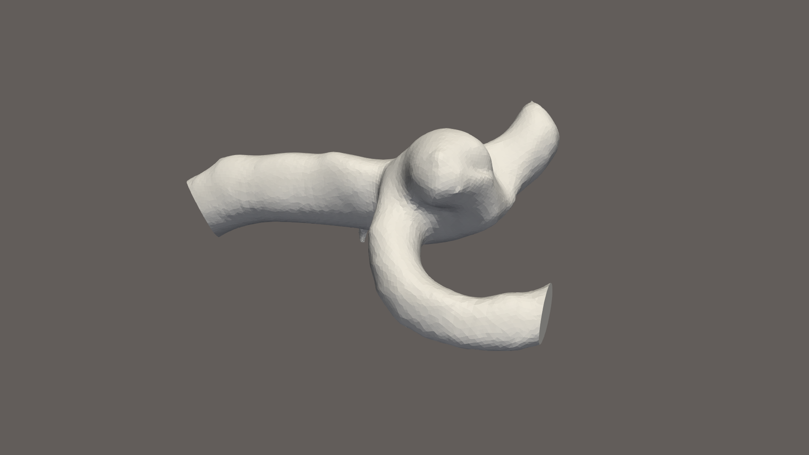
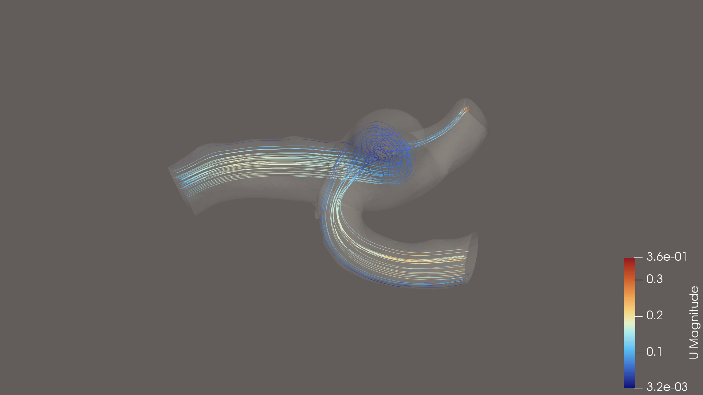
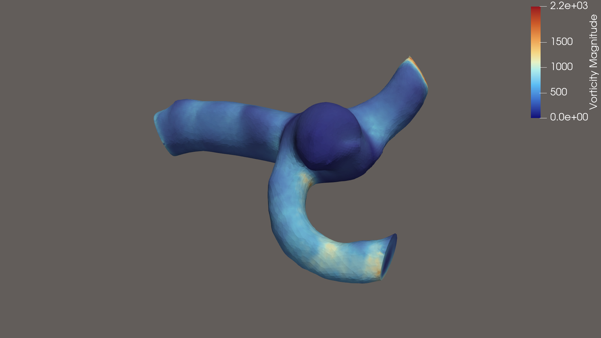
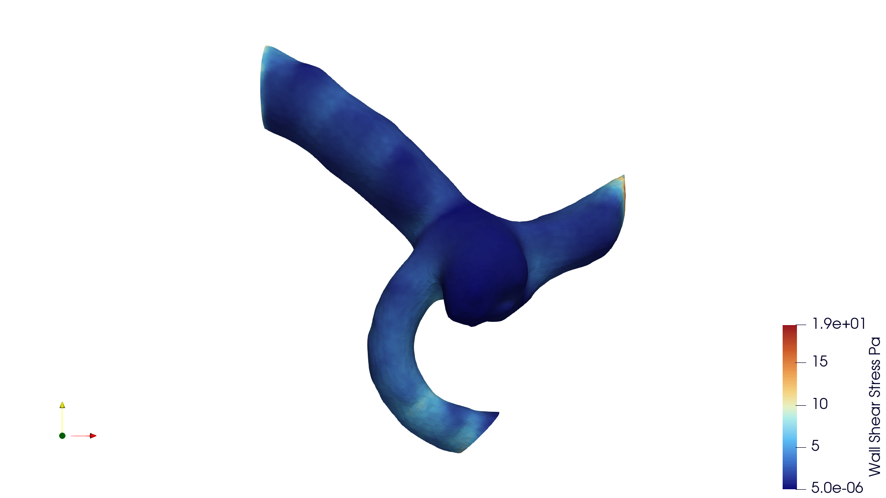

# Patient-Derived Intracranial Aneurysm CFD: Interim Technical Report

**Project:** Aneurysm Computational Fluid Dynamics  
**Status:** Exploratory — interim results  
**Report date:** 2 November 2026  
**Repository:** [aneurysm-cfd](https://github.com/T-Y-Ang/aneurysm-cfd)

## 1. Executive Summary

This project investigates the feasibility of constructing a reproducible computational fluid dynamics (CFD) workflow for intracranial aneurysm haemodynamics using open-source software and publicly available vascular geometry.

Development began with a synthetic sidewall aneurysm demonstration and progressed to a patient-derived left middle cerebral artery (MCA) aneurysm model from the Royal Brisbane TOF-MRA Intracranial Aneurysm dataset, available through OpenNeuro (ds005096).

A preliminary steady-state, incompressible-flow simulation was completed using the patient-derived geometry. Initial results included flow-field computation, mass-conservation verification and wall shear stress (WSS) calculation.

Subsequent mesh refinement and geometry inspection identified limitations requiring further work, including mesh-quality warnings and a possible artificial narrowing at one outlet caused by incomplete removal of an original surface cap.

The project is therefore presented as an exploratory computational demonstration, not a validated patient-specific haemodynamic model.

## 2. Objectives

The project aims to:

1. Establish a reproducible pipeline from vascular surface geometry to computational flow simulation.
2. Generate and assess three-dimensional tetrahedral meshes suitable for CFD.
3. Simulate blood flow through a patient-derived aneurysm geometry.
4. Explore velocity distributions, flow patterns and wall shear stress.
5. Identify sources of numerical and geometric uncertainty.
6. Develop a foundation for future mesh-convergence studies, physiological boundary conditions and comparative haemodynamic analysis.

## 3. Software and Computational Environment

The workflow uses:

- Python for geometry processing, mesh inspection and automation.
- Gmsh for geometry and mesh processing.
- TetGen for tetrahedral volume meshing.
- OpenFOAM Foundation 14 for CFD simulation.
- ParaView for mesh inspection and flow visualisation.
- A Windows workstation with Ubuntu running under WSL.

The workflow is organised into separate geometry, mesh, simulation-case, script and output directories to support reproducibility.

## 4. Patient-Derived Geometry

*Figure 1. Reconstructed patient-derived MCA aneurysm geometry used for preliminary CFD analysis. The outlet geometry remains under review.*

### 4.1 Source data

The patient-derived demonstration uses an openly available intracranial aneurysm surface model from OpenNeuro dataset ds005096, subject `sub-038`.

The selected anatomy represents a left MCA aneurysm with associated parent and branching vessels.

The supplied surface underwent cleaning, clipping, reconstruction of three vessel openings and surface remeshing.

### 4.2 Geometry preparation

The computational domain was prepared with:

- One proximal inlet.
- Two distal outlets.
- A vessel-wall surface.
- Reconstructed planar caps to produce a closed surface suitable for volume meshing.

The final remeshed surface contained approximately 28,450 triangles and was verified as watertight.

### 4.3 Outstanding geometry concern

Inspection of the source and clipped surfaces raised a concern that an oblique terminal cap in the original dataset may have been incompletely removed during clipping.

A retained cap fragment could artificially narrow one outlet and influence local haemodynamics and flow partitioning.

Three open boundaries were identified in the clipped geometry. Their approximate equivalent diameters were 3.260 mm, 1.474 mm and 1.829 mm, based on projected convex-hull area estimates.

These measurements do not establish whether an artificial narrowing is present.

The suspected geometry artefact remains unresolved. A revised outlet cut and subsequent geometry validation are required before further interpretation of patient-derived flow results.

## 5. Volume Mesh Generation and Quality Assessment

### 5.1 Baseline mesh

A baseline tetrahedral mesh was generated with approximately:

- **117,490 tetrahedral elements**
- **26,919 nodes**
- **169.834 mm³ enclosed volume**

The mesh was imported into OpenFOAM and converted from millimetres to metres.

Mesh validation identified several limitations, including 290 underdetermined cells, 43 low-interpolation-weight faces and three faces exceeding 70° non-orthogonality.

These warnings were retained as part of the numerical-quality assessment rather than disregarded.

### 5.2 Refined mesh

A second mesh was generated with approximately:

- **221,743 tetrahedral elements**
- **43,840 nodes**
- **169.834 mm³ enclosed volume**

The refined mesh preserved the enclosed volume while increasing the tetrahedral element count.

The proportion of underdetermined cells decreased, and average non-orthogonality improved. However, mesh-quality warnings remained, including 316 underdetermined cells, 56 low-weight faces and five faces exceeding 70° non-orthogonality.

An additional attempt to increase TetGen optimisation iterations did not change the refined mesh.

The refined mesh was successfully imported into OpenFOAM, but a corresponding flow simulation has not yet been completed.

**Mesh independence has not been demonstrated.**

## 6. CFD Model and Boundary Conditions

The preliminary patient-derived simulation employed a steady-state, incompressible, laminar-flow formulation.

The model used:

| Parameter | Value |
|---|---|
| Blood density | 1,060 kg/m³ |
| Kinematic viscosity | 3.3019 × 10⁻⁶ m²/s |
| Inlet velocity | Uniform 0.10 m/s in global X direction |
| Outlet pressure | Zero gauge kinematic pressure at both outlets |
| Vessel wall | Stationary no-slip |
| Vessel compliance | Rigid-wall assumption |

These boundary conditions were selected to establish a functioning computational demonstration.

They are not derived from subject-specific haemodynamic measurements. In particular, the imposed inlet velocity direction and the use of equal-pressure outlets require further assessment before physiological interpretation.

The model does not represent pulsatile flow, vessel-wall deformation or patient-specific distal vascular resistance.

## 7. Preliminary Results

*Figure 2. Preliminary velocity streamlines from the baseline steady-state CFD simulation of the patient-derived MCA aneurysm. These results have not undergone mesh-independence testing, and the suspected outlet geometry artefact remains unresolved.*

### 7.1 Solver completion

The baseline steady-state OpenFOAM simulation completed at iteration 663.

This establishes that the initial computational workflow could produce a numerical flow solution for the prepared patient-derived geometry.

Solver completion alone does not establish mesh independence, physiological accuracy or clinical validity.

### 7.2 Mass conservation

Reported volumetric flow rates were approximately:

| Boundary | Flow rate |
|---|---:|
| Inlet | −8.3324684 × 10⁻⁷ m³/s |
| Outlet 1 | +3.4642152 × 10⁻⁷ m³/s |
| Outlet 2 | +4.8682530 × 10⁻⁷ m³/s |

The resulting relative mass-flow imbalance was approximately 0.0000024%, based on the reported boundary fluxes.

This indicates excellent global mass conservation for the computed solution. It does not independently validate the anatomical geometry or local flow-field accuracy.

### 7.3 Vorticity visualisation

*Figure 3. Preliminary vorticity visualisation from the baseline patient-derived MCA aneurysm CFD simulation. Vorticity describes the local rotation of the velocity field. Interpretation remains limited by the unresolved outlet geometry concern and mesh-quality issues.*

### 7.4 Wall shear stress

*Figure 4. Preliminary wall shear stress distribution from the baseline steady-state CFD simulation of the patient-derived MCA aneurysm. The results are exploratory and have not been validated through mesh-convergence testing or physiological boundary-condition sensitivity analysis. The suspected outlet geometry artefact remains unresolved.*

Wall shear stress was calculated from the OpenFOAM wall-shear-stress field and converted to pascals using the assumed blood density.

Preliminary visualisation indicated values extending approximately from 0 to 19 Pa.

These results are exploratory and have not been assessed for sensitivity to mesh resolution, outlet geometry, boundary conditions or flow pulsatility.

No inference regarding aneurysm rupture risk can be drawn from these preliminary values.

## 8. Limitations

The principal limitations are:

**Geometric uncertainty:** A possible residual oblique cap at an outlet may alter the computational lumen.

**Mesh quality:** Both baseline and refined meshes retain quality warnings. A systematic mesh-convergence assessment remains outstanding.

**Boundary conditions:** Uniform inlet velocity and equal-pressure outlets are simplified assumptions rather than patient-specific physiological measurements.

**Flow modelling:** The current simulation assumes steady, laminar, Newtonian, incompressible flow through rigid vessels.

**Numerical verification:** Global mass conservation was assessed, but formal grid convergence, sensitivity analysis and independent validation remain incomplete.

**Clinical interpretation:** The results are unsuitable for predicting aneurysm rupture, determining treatment indications or guiding individual patient management.

## 9. Future Development

The next phase will prioritise:

1. Correcting and validating the potentially restricted upper vessel outlet.
2. Rebuilding the closed geometry and tetrahedral mesh.
3. Repeating the baseline and refined CFD simulations using consistent boundary conditions.
4. Comparing flow rates, velocity distributions, pressure fields and WSS between mesh resolutions.
5. Assessing more physiologically appropriate inlet and outlet conditions.
6. Producing reproducible flow visualisations and documenting numerical uncertainty.

Longer-term extensions may include pulsatile flow, alternative vascular geometries and comparative haemodynamic investigations.

## 10. Interim Conclusion

This project has established a functional open-source CFD workflow extending from patient-derived aneurysm geometry through tetrahedral meshing, numerical flow simulation and preliminary wall shear stress analysis.

The work has also demonstrated the importance of geometric fidelity, mesh quality and boundary-condition selection in computational haemodynamics.

The initial results are technically informative but remain preliminary. In particular, the unresolved outlet geometry concern and absence of mesh-convergence evidence prevent reliable physiological interpretation.

Development is temporarily paused while a complementary spinal finite element analysis project is prioritised. The existing CFD scripts, meshes and simulation outputs will be preserved to support subsequent correction, verification and extension.

**Project classification: Exploratory computational demonstration — preliminary results, further validation required.**